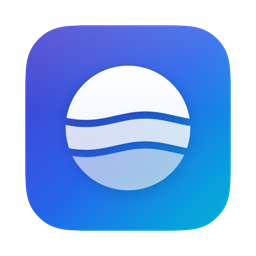
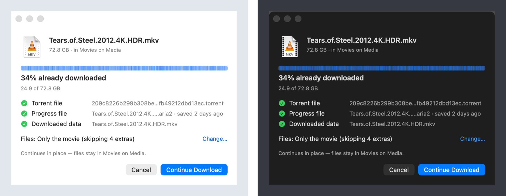

<p align="center">
  
</p>

<h1 align="center">Tide</h1>

<p align="center">
  A fast, native download manager for Mac, built on aria2.<br>
  Torrents, magnet links and direct downloads, right from your menu bar.
</p>

<p align="center">
  <a href="https://github.com/nizarmasri/Tide/releases/latest"><strong>Download for macOS</strong></a>
  &nbsp;·&nbsp;
  <a href="#features">Features</a>
  &nbsp;·&nbsp;
  <a href="#build-from-source">Build from source</a>
</p>

<p align="center">
  
</p>

## Why

aria2 is one of the best download engines out there. It's fast, it does torrents and plain links, and it picks up where it left off. Driving it from the terminal gets old, though, and most apps built on top of it are heavy Electron wrappers.

Tide is a small native Mac app around aria2. The interface is SwiftUI, the engine work happens in Rust, and aria2 is bundled inside the app so there's nothing else to install. The whole thing is a 16 MB download and sits at practically zero CPU when nothing is happening.

## Features

- **Lives in the menu bar.** One click shows what's downloading, how fast, and when it'll be done. The full window is there when you want it.
- **Add anything.** Drop in a `.torrent` file, paste a magnet link or a URL. Tide can also be your default app for magnet links and torrent files.
- **Takes the movie, skips the junk.** For torrents, Tide selects the main video and leaves out samples, `.txt`/`.nfo` files and images. You can change the selection whenever you like.
- **Resumes instantly.** Tide uses aria2's own progress files, so restarting a download never means re-checking 70 GB of data. After a crash or a power cut it only checks the few pieces that could be damaged.
- **Continues your existing aria2 downloads.** Point it at a folder and it finds unfinished downloads (the torrent plus aria2's `.aria2` file) and carries on in place, from exactly where they stopped.
- **Scheduling.** Set download hours, a slow mode for when you need the bandwidth, or start a download at a specific time.
- **External drives just work.** Unplug the drive and its downloads wait. Plug it back in and they continue.
- **Behaves on your Mac.** Keeps it awake only while something is downloading, can pause on battery or on a phone hotspot, and lets you know when a download finishes.
- Pause and resume everything at once, per-download speed limits, file and peer details, search and keyboard shortcuts.

<p align="center">
  
</p>

<p align="center">
  
  <br>
  <sub>Picking up a half-finished aria2 download without hashing the whole file.</sub>
</p>

## Install

1. Download `Tide-1.0.0-macOS.zip` from the [latest release](https://github.com/nizarmasri/Tide/releases/latest).
2. Unzip it and drag **Tide** into your Applications folder.
3. Open it. The first time, macOS says it can't verify the app because it isn't notarized. Open **System Settings → Privacy & Security**, scroll down and click **Open Anyway**. You only do this once.

Tide needs macOS 26 (Tahoe) or later on an Apple silicon Mac.

## Build from source

You'll need Xcode 26 or later, Rust, and aria2 from Homebrew (the build copies it into the app).

```sh
brew install aria2
scripts/bootstrap.sh    # installs Rust with rustup if you don't have it
scripts/build.sh        # builds everything and installs ~/Applications/Tide.app
```

The app is signed ad hoc by default. To sign with your own certificate, set `SIGN_IDENTITY` or put the identity name in `scripts/.signing-identity`.

Run the tests with:

```sh
(cd core && cargo test -p tide-core)
(cd app && swift test)
```

### How it's put together

- `core/` is the Rust engine. It runs aria2, talks to it over its JSON-RPC WebSocket API, reads and writes aria2's `.aria2` progress files, verifies pieces in parallel and keeps track of your downloads and schedule. It's exposed to Swift through UniFFI.
- `app/` is the SwiftUI and AppKit app: the menu bar item, windows, settings and system integration.
- `docs/DESIGN.md` has the design notes behind the interface.

## License

MIT. Tide ships with aria2 and a few libraries it depends on, each under its own license. See [THIRD_PARTY_NOTICES.md](THIRD_PARTY_NOTICES.md).
