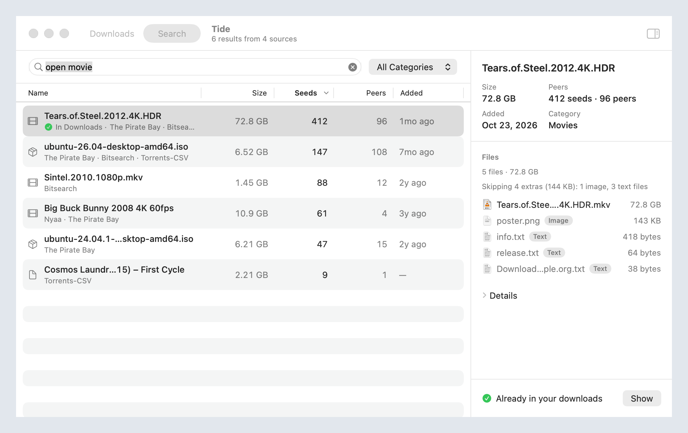
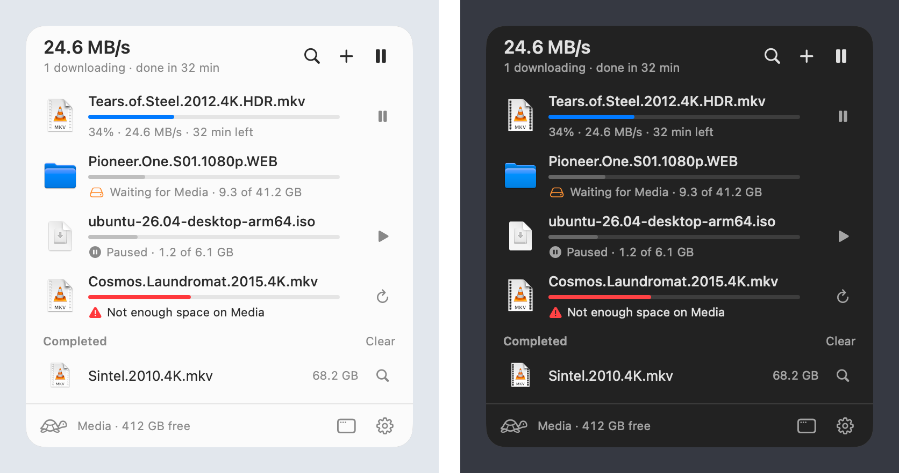
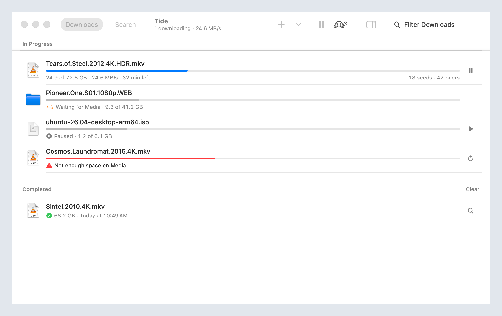

<p align="center">
  
</p>

<h1 align="center">Tide</h1>

<p align="center">
  <strong>Find it. Download it. Done.</strong><br>
  The fast, native torrent app for Mac. Search the big public torrent indexes from one bar,<br>
  see the seeds and files before you download, and watch it all from your menu bar.
</p>

<p align="center">
  <a href="https://github.com/nizarmasri/Tide/releases/latest"></a>
  
  
  
  
  <a href="LICENSE"></a>
</p>

<p align="center">
  <a href="https://github.com/nizarmasri/Tide/releases/latest"><strong>Download for macOS</strong></a>
  &nbsp;·&nbsp;
  <a href="#features">Features</a>
  &nbsp;·&nbsp;
  <a href="#build-from-source">Build from source</a>
</p>

<p align="center">
  
</p>

## Why Tide

Getting a torrent usually means two apps and a lot of friction: a website full of pop-ups to find it, then a client that looks twenty years old to download it. Tide does both in one small, native Mac app.

- **Search is built in.** Type a name and press Return. Tide asks several big public indexes at once, merges the duplicates and gives you one clean list, sorted by seeds. No browser, no ads, no account.
- **Look before you download.** See what's inside a torrent, how big it is, how many people are sharing it and where it was found. Tide picks the main video and skips the junk for you.
- **Native and light.** SwiftUI and Rust around the aria2 engine, bundled in a 16 MB app that sits at practically zero CPU when nothing is happening. No Electron, nothing else to install.

## Features

- **Search the big torrent indexes at once.** One search bar asks Knaben (which covers YTS, Nyaa and more), Bitsearch, Torrents-CSV and others in parallel. Copies of the same torrent are merged into one row with the best seed count, so the healthiest download is always on top. Free, with no account or API key. Open it with ⌘2, or ⇧⌘F from anywhere.
- **See inside before you download.** Every result shows its files, size, seeds, peers and age. When Tide can get the torrent file, the Add window shows the real file list and the download starts right away, without waiting for peers to send it.
- **Lives in the menu bar.** One click shows what's downloading, how fast, and when it'll be done. The full window is there when you want it.
- **Add anything.** Drop in a `.torrent` file, paste a magnet link or a URL. Tide can also be your default app for magnet links and torrent files.
- **Takes the movie, skips the junk.** For torrents, Tide selects the main video and leaves out samples, `.txt`/`.nfo` files and images. You can change the selection whenever you like.
- **Resumes instantly.** Tide uses aria2's own progress files, so restarting a download never means re-checking 70 GB of data. After a crash or a power cut it only checks the few pieces that could be damaged.
- **Continues your existing aria2 downloads.** Point it at a folder and it finds unfinished downloads (the torrent plus aria2's `.aria2` file) and carries on in place, from exactly where they stopped.
- **Scheduling.** Set download hours, a slow mode for when you need the bandwidth, or start a download at a specific time.
- **External drives just work.** Unplug the drive and its downloads wait. Plug it back in and they continue.
- **Behaves on your Mac.** Keeps it awake only while something is downloading, can pause on battery or on a phone hotspot, and lets you know when a download finishes.
- Pause and resume everything at once, per-download speed limits, file and peer details, filtering and keyboard shortcuts.

<p align="center">
  
  <br>
  <sub>Everything at a glance from the menu bar, with search one click away.</sub>
</p>

<p align="center">
  
  <br>
  <sub>Downloads and Search live in one window. Switch with the control in the toolbar.</sub>
</p>

<p align="center">
  
  <br>
  <sub>Picking up a half-finished aria2 download without hashing the whole file.</sub>
</p>

## Install

1. Download `Tide-1.1.0-macOS.zip` from the [latest release](https://github.com/nizarmasri/Tide/releases/latest).
2. Unzip it and drag **Tide** into your Applications folder.
3. Open it. The first time, macOS says it can't verify the app because it isn't notarized. Open **System Settings → Privacy & Security**, scroll down and click **Open Anyway**. You only do this once.

Tide needs macOS 26 (Tahoe) or later on an Apple silicon Mac.

Tide searches public indexes and doesn't host any files. Download only what you have the right to.

## Build from source

You'll need Xcode 26 or later, Rust, and aria2 from Homebrew (the build copies it into the app).

```sh
brew install aria2
scripts/bootstrap.sh    # installs Rust with rustup if you don't have it
scripts/build.sh        # builds everything and installs ~/Applications/Tide.app
```

The app is signed ad hoc by default. To sign with your own certificate, set `SIGN_IDENTITY` or put the identity name in `scripts/.signing-identity`.

Run the tests with:

```sh
(cd core && cargo test -p tide-core)
(cd app && swift test)
(cd app && TIDE_LIVE_SEARCH=1 swift test --filter LiveSearchTests)   # checks every search source live
```

### How it's put together

- `core/` is the Rust engine. It runs aria2, talks to it over its JSON-RPC WebSocket API, reads and writes aria2's `.aria2` progress files, verifies pieces in parallel and keeps track of your downloads and schedule. It's exposed to Swift through UniFFI.
- `app/` is the SwiftUI and AppKit app: the menu bar item, windows, settings and system integration. Torrent search lives in `app/Sources/TideKit/Search`: one small adapter per index, merging by info hash, and plain `URLSession` with no extra dependencies.
- `docs/DESIGN.md` has the design notes behind the interface.

## License

MIT. Tide ships with aria2 and a few libraries it depends on, each under its own license. See [THIRD_PARTY_NOTICES.md](THIRD_PARTY_NOTICES.md).
